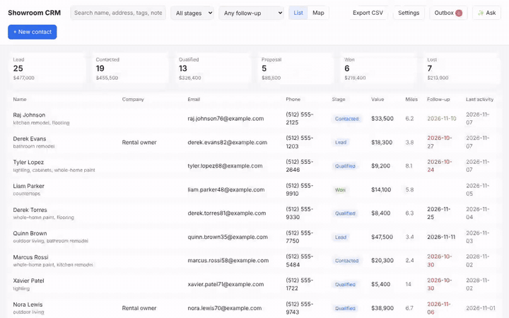
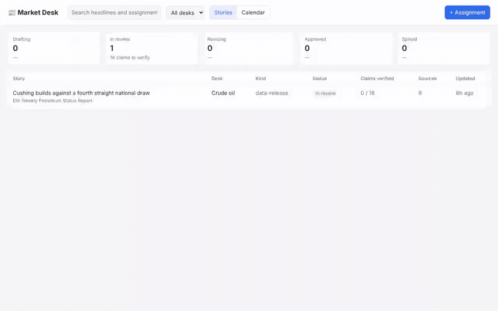
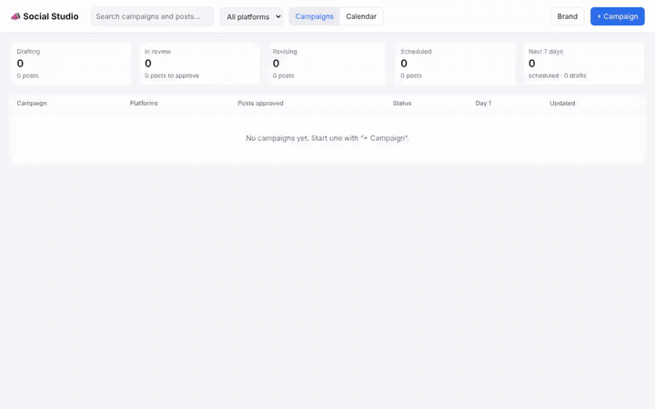

# HarnessGateway demos

Three small business applications with an agent inside each, built on a
[HarnessGateway](https://github.com/HarnessGateway/harnessgateway) platform the way a customer would build them. Each is
an ordinary web app with its own SQLite database. It holds one API key **that can only run turns**, sends **OpenAI
Responses** requests to the platform, and reads the agent's work back through the **OpenAI Containers API**. The agent
in each is **one harness package**: a coding-agent CLI as its makers ship it, plus the standing instructions that make
it this app's agent. Each is on a different CLI.

| Demo | The application | The agent in it | On |
|---|---|---|---|
| [`crm/`](crm/) | A showroom's CRM: 75 customers on a pipeline and a map, follow-ups, an activity log, an Outbox | a sales agent that reads the whole CRM, answers with names and numbers, plans routes, and drafts emails and texts into the Outbox | [`sales-codex`](packages/sales-codex/): Codex, speaking the OpenAI Responses API to its provider |
| [`market-desk/`](market-desk/) | A commodities newsroom's desk: assignments, a release calendar, review by status | a journalist that reads the desk's primary sources and files a cited draft with charts, sources and the claims to verify | [`journalist-pi`](packages/journalist-pi/): pi, speaking the Anthropic Messages API |
| [`social/`](social/) | A social media calendar: campaigns, a post per platform, a two-week calendar | a social media manager that writes each platform's post, plans the sequence, tags links and cross-links the posts | [`social-claude-code`](packages/social-claude-code/): Claude Code, speaking the Anthropic Messages API |

Each app has a short recording of it in use, live (made on an earlier version of the platform; the apps are the same): [`crm/demo.mp4`](crm/demo.mp4),
[`market-desk/demo.mp4`](market-desk/demo.mp4) and [`social/demo.mp4`](social/demo.mp4). The minutes the agent spends
working are sped up and labelled as such; nothing else is cut.

| [Showroom CRM](crm/) | [Market Desk](market-desk/) | [Social Studio](social/) |
|---|---|---|
| [](crm/demo.mp4) | [](market-desk/demo.mp4) | [](social/demo.mp4) |

The previews play at double speed; click one for the full recording.

In every one, **the person decides**: the CRM sends only what someone presses Send on, the desk approves only what an
editor checked claim by claim, and the studio schedules only the posts someone approved. The agents draft.

## Running them

You need a HarnessGateway (4.0 or later), an admin key, and one provider on it with base URLs for the OpenAI
Responses API and the Anthropic Messages API.

```bash
git clone https://github.com/HarnessGateway/demos && cd demos
scripts/setup.py --api http://localhost:8000 --admin-key-file ~/admin.key --provider <the provider's name>
python3 crm/server.py          # http://127.0.0.1:8900
python3 market-desk/server.py  # http://127.0.0.1:8910
python3 social/server.py       # http://127.0.0.1:8920
```

`setup.py` adds the three packages, makes the environment the social media manager runs in, creates one key per app
that can only run turns, and writes each app's `.env` (`HG_API`, `HG_KEY`, `HG_MODEL`). The model is
`[environment:]harness/provider[/model]`.

The apps are standard-library Python servers and plain JavaScript pages, on purpose: nothing hides how the platform is
used. [`common/hg.py`](common/hg.py) is the whole client.

## How the packages are made

A harness package is a folder: `harness.json`, `install`, `run`, and seed files. Each package here takes `install` and
`run` unchanged from the package of its CLI in [harness-packages](https://github.com/HarnessGateway/harness-packages)
and adds what makes it this app's agent under `seeds/mind/`: the standing instructions the CLI reads from its own dot
directory, with the output contract the app parses, and reference material. Nothing about the agent's job is in the
platform, and nothing about the CLI is in the app. See [`packages/`](packages/).

## What each demo shows of the platform

- **Input files.** The CRM sends its snapshot as an `input_file` with each question. The agent finds it in its work
  folder, replaced with the fresh one every turn.
- **Sessions as memory.** One session per chat, per story and per campaign. A follow-up or a revision sends
  `previous_response_id`, and the agent continues with its own memory and the files it wrote.
- **Background turns.** The apps start a turn and poll it, showing the agent's commands as it works. A page can be
  closed and reopened while the agent works.
- **Reading the agent's work.** The desk and the studio list and download the files the agent wrote through the
  Containers API. No sandbox runs for that.
- **Output contracts.** Each agent ends its answer with one fenced JSON block (`crm-drafts`, `desk-report`,
  `social-plan`) that its package's instructions define and its app parses.
- **The sandbox decides what an agent can reach.** The sales agent reaches nothing but its model. The journalist
  reaches its model and the primary sources its package names. The social media manager runs in an environment that
  reaches the public web and refuses the social platforms' APIs. All of it is enforced outside the sandbox.
- **No keys in the apps or the sandbox.** An app holds only its own key. The provider's key is put into requests by
  the platform's proxy, on the way out of the sandbox.
