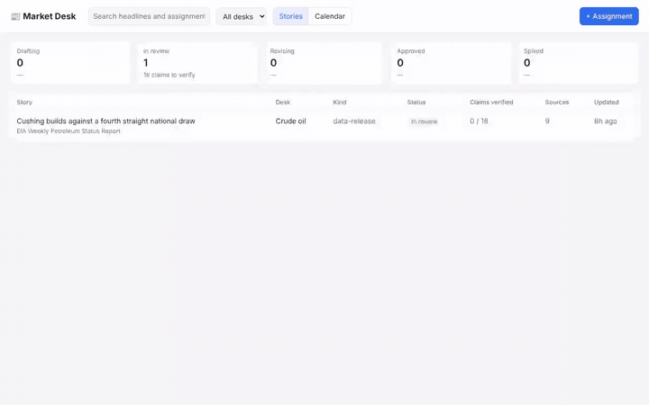

# Market Desk, with a journalist agent in it

A commodities newsroom's desk app for two desks, biofuels and crude oil. Editors assign stories, by hand or from the
desk's **release calendar** (daily briefings, the EIA Weekly Petroleum Status Report on Wednesdays, the weekly wraps,
monthly releases). Each story goes to a **journalist agent**: the [`journalist-pi`](../packages/journalist-pi/)
harness package on HarnessGateway, the pi coding agent tailored to the desk. It reads only the desk's primary sources
(EIA, EPA, CARB, the Federal Register, USDA), writes a cited draft with charts, lists its sources and every claim a
person must verify, and files it. The editor reads the draft, ticks off each claim, sends it back with a note or
approves it. Nothing is published from here.

[](demo.mp4)

The preview above plays at double speed; click it for [`demo.mp4`](demo.mp4), the full recording. It is this desk in use, recorded live: an assignment from the calendar, the agent reporting from EIA's data, the filed draft with its chart, claims ticked off, the sources, and approval. The minutes the agent spends working are shown at 12x speed and labelled; nothing else is cut.

```bash
python3 server.py            # http://127.0.0.1:8910 ; HG_API, HG_KEY, HG_MODEL from ./.env (scripts/setup.py)
```

Stories live in `desk.db` (SQLite), made on first start.

## How the agent is wired in

| In the desk | On the platform |
|---|---|
| Assign a story | a **background** Responses request whose input names the desk and the kind of task (briefing, data-release, market-wrap, explainer, news-short, research) |
| The agent's steps while it reports | the turn's events, streamed while it runs (`GET /v1/responses/{id}?stream=true`); its final state is read when it ends |
| The filed draft, its charts, sources and claims | the agent ends with one fenced `desk-report` block naming the folder it wrote; the desk reads `draft.md`, `sources.json`, `verify.md` and the PNG charts from it with the **Containers API**, relayed so the browser never holds the key |
| Send back with a note | `previous_response_id`: the same **session**, so the agent revises its own files |
| Only the primary sources | the package's `run.egress` lists those hosts; the platform's proxy, the sandbox's only way out, refuses every other host |

## Files

| File | What it is |
|---|---|
| `server.py` | the desk: SQLite, the calendar, assignments, revisions, reading the agent's folder back |
| `index.html` | the page: pipeline by status, stories, calendar, and the story drawer (draft, verify, sources, agent) |
| `.env` | written by `scripts/setup.py`: `HG_API`, `HG_KEY` (a key named `demo-market-desk` that can only run turns), `HG_MODEL` |
