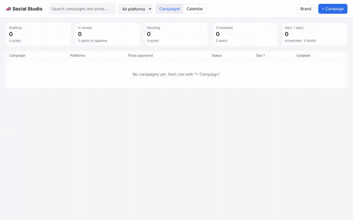

# Social Studio, with a social media manager agent in it

A small business's social media calendar. A campaign promotes one piece of content (a page to read, or pasted text)
on the platforms you pick. A **social media manager agent**, the [`social-claude-code`](../packages/social-claude-code/)
harness package on HarnessGateway (Claude Code tailored to the job), reads it and writes a post per platform in that
platform's idiom and limits: an X post or thread, a LinkedIn post, an Instagram caption with alt text for the image,
Threads, Bluesky, Mastodon and Facebook. It plans the sequence over the first days, tags every link with UTM parameters
per platform and cross-links the posts, and explains the plan. You edit each post (with a live character count against
the platform's limit), set its time, ask the agent to revise one post or the whole plan, and approve it onto the
calendar. **Nothing is posted anywhere**: the agent's package forbids every social platform's API, and the calendar
is this demo's stand-in for a scheduler.

[](demo.mp4)

The preview above plays at double speed; click it for [`demo.mp4`](demo.mp4), the full recording. It is the studio in use, recorded live: the brand, a campaign from an example, the agent drafting it, the four posts and the strategy, approval, and the posts on the calendar. The minutes the agent spends working are shown at 14x speed and labelled; nothing else is cut.

```bash
python3 server.py            # http://127.0.0.1:8920 ; HG_API, HG_KEY, HG_MODEL from ./.env (scripts/setup.py)
```

Campaigns live in `social.db` (SQLite), made on first start. **Brand** holds the name, site, voice and time zone every
campaign request carries; the two example campaigns are for the same Austin showroom as the CRM demo.

## How the agent is wired in

| In the studio | On the platform |
|---|---|
| Draft the campaign | a **background** Responses request; the campaign's slug, the platforms, the brand, goal, audience, canonical URL and the content (or the URL to read) are all in the input |
| The plan, its posts and times | the agent ends with one fenced `social-plan` block of JSON (the same document as `campaigns/<slug>/plan.json` in its work folder); `strategy.md` is read with the **Containers API** |
| Revise one post, or the plan | `previous_response_id`: the same **session**, so the agent edits its own files; approved posts are named so it keeps them |
| Read a page, post nowhere | the agent runs in the environment `web` (the model is `web:social-claude-code/…`): its sandbox reaches the public web, and the platform's proxy refuses every social platform's API |

## Files

| File | What it is |
|---|---|
| `server.py` | the studio: SQLite, campaigns, runs, reading the plan back, resolving "day 2 09:00" to dates |
| `index.html` | the page: campaigns, a two-week calendar, the campaign drawer (posts, strategy, brief, agent), the brand |
| `.env` | written by `scripts/setup.py`: `HG_API`, `HG_KEY` (a key named `demo-social` that can only run turns), `HG_MODEL` |
